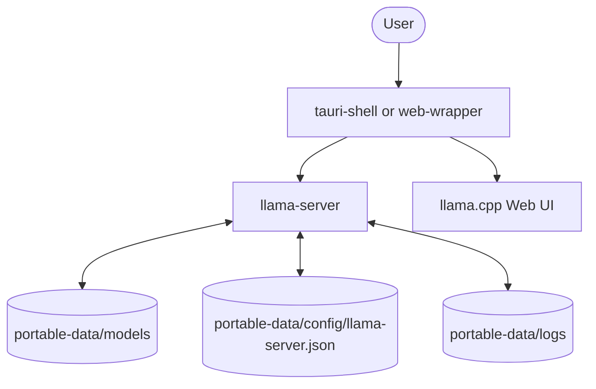

# llama-cpp-webui-wrapper

Portable desktop shell for the bundled llama.cpp web UI.

  

<!-- SCREENSHOT PLACEHOLDER: hero image of built-in web UI running in the native Windows window -->
_Screenshot coming soon._

## Features

- Bundles the latest ggml-org/llama.cpp server and UI into a standalone Windows
  application.
- Fast, native desktop window via Tauri 2.
- Node.js fallback wrapper that uses an existing Edge or Chrome installation.
- Simple configuration via a standard JSON file.
- Portable mode: models, settings and logs in a single directory folder.
- Direct download and sync of model catalogs.

## Architecture



A desktop shell (`tauri-shell` or `web-wrapper`) manages a `llama-server`
process. It provides a native window or browser app pointing to the server's
bundled web UI. The server reads configuration, writes logs, and loads models
from the `portable-data` directory.

## Quick start

### Portable app (Windows x64 CUDA)

1. Download `Llama-WebUI-windows-x64-cuda.zip` from the
   [releases page](https://github.com/walladanger/llama-cpp-webui-wrapper/releases).
2. Extract the ZIP file.
3. Put `.gguf` model files in `portable-data\models`.
4. Double-click `llama-webui.exe`.

### From source (Windows)

Prerequisites: CMake, Visual Studio Build Tools, Node.js (for web-wrapper),
Rust (optional, for tauri-shell).

```powershell
# Run the setup script to build the server, UI and shells.
.\Setup-Llama-WebUI.ps1

# Start the application using the generated desktop shortcut or script.
.\Run-Llama-WebUI.ps1
```

## Configuration

The server reads `portable-data\config\llama-server.json`. The launcher and
wrappers will pass these settings to `llama-server` when starting.

| Setting | Purpose | Default |
| --- | --- | --- |
| `ctx_size` | Context window size | `0` |
| `fit` | Enable context fitting | `true` |
| `fit_target` | Fit target | `"1024"` |
| `fit_ctx` | Fit context | `"4096"` |
| `n_gpu_layers` | Number of layers to offload to GPU | `-1` |
| `gpu_placement` | GPU placement strategy | `"manual"` |
| `flash_attn` | Flash attention | `"auto"` |
| `concurrent_slots` | Number of concurrent requests | `8` |

## Screenshots

<!-- SCREENSHOT PLACEHOLDER: hero image of the terminal log window alongside the native UI -->
_Screenshot coming soon._

## Roadmap

See issues.

## License & credits

[MIT License](LICENSE)

Based on ggml-org/llama.cpp. For llama.cpp documentation, see
[docs/README-llama.cpp.md](docs/README-llama.cpp.md).
